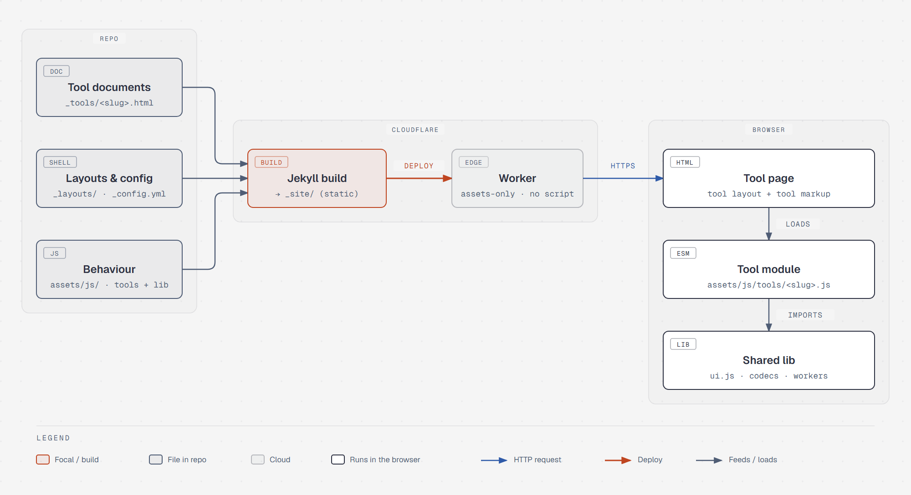
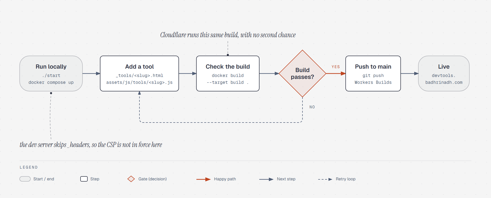

# devtools.badhrinadh.com

Developer tools that run entirely in the browser, at
[devtools.badhrinadh.com](https://devtools.badhrinadh.com).

## Sources

Ported from [True Devtools](https://github.com/dathoangnd/truedevtools.com) by
Dat Hoang (MIT). The JSON / YAML converter comes from the
[Backstage toolbox plugin](https://github.com/drodil/backstage-plugin-toolbox)
(MIT).

## Licence

MIT, same as the project it came from.
